# Exploratory Data Analysis (synthetic data)

> Synthetic dataset - findings describe the simulation, not a real plant.

**Merged dataset:** 300,000 events x 30 columns; labelled & valid: 299,870; period 2023-01-01 to 2024-12-31.

|                            |   count |    mean |    std |     min |     25% |     50% |     75% |      max |
|:---------------------------|--------:|--------:|-------:|--------:|--------:|--------:|--------:|---------:|
| production_volume_l        |  299960 | 4988.62 | 834.07 | 1076.7  | 4348.6  | 4894.7  | 5540.6  | 17561.8  |
| production_duration_min    |  299979 |  125.86 |  20.71 |   30.2  |  113.8  |  124    |  135.3  |   575.8  |
| machine_speed              |  300000 |  117.89 |  16.69 |   26.3  |  103.3  |  118.1  |  130.6  |   168.2  |
| ambient_temperature        |  299975 |   28.99 |   4.38 |   15.39 |   25.7  |   28.99 |   32.29 |    42.59 |
| raw_material_age           |  299850 |   16.58 |  11.17 |    1    |    8.6  |   13.9  |   21.6  |    72    |
| fat_percentage             |  296348 |    3.82 |   0.28 |    2.61 |    3.62 |    3.81 |    4.01 |     5.15 |
| protein_percentage         |  296154 |    3.3  |   0.15 |    2.7  |    3.2  |    3.3  |    3.4  |     3.96 |
| acidity                    |  297434 |    0.15 |   0.01 |    0.1  |    0.14 |    0.15 |    0.16 |     0.25 |
| raw_material_quality_score |  299850 |   81.62 |  10.47 |    8.7  |   78.2  |   83.8  |   88.1  |   100    |
| machine_temperature        |  299551 |   71.99 |   1.04 |   63.54 |   71.35 |   72    |   72.64 |    79.75 |
| pressure                   |  296691 |    2.57 |   0.16 |    1.82 |    2.47 |    2.57 |    2.68 |     3.28 |
| downtime                   |  299700 |    4.23 |  10.13 |    0    |    0    |    0    |    5.1  |   239.9  |
| maintenance_age_days       |  299700 |   36.25 |  22.03 |    0    |   18    |   35    |   53    |    95    |
| vibration                  |  291996 |    2.65 |   0.67 |    0.97 |    2.21 |    2.56 |    2.98 |    15.25 |
| moisture_percentage        |  252309 |   87.5  |   0.39 |   84.38 |   87.28 |   87.5  |   87.72 |    90.18 |

## Accepted vs Rejected Batches

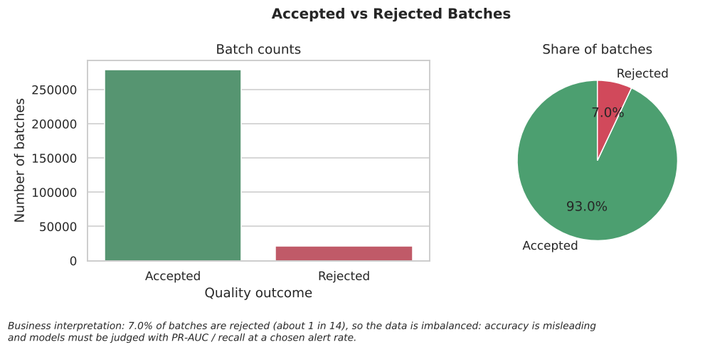

**Business interpretation:** 7.0% of batches are rejected (about 1 in 14), so the data is imbalanced: accuracy is misleading and models must be judged with PR-AUC / recall at a chosen alert rate.

## Rejection Rate by Production Line (95% CI)

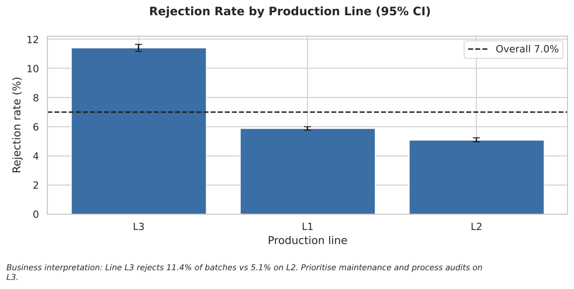

**Business interpretation:** Line L3 rejects 11.4% of batches vs 5.1% on L2. Prioritise maintenance and process audits on L3.

## Rejection Rate by Supplier (95% CI)

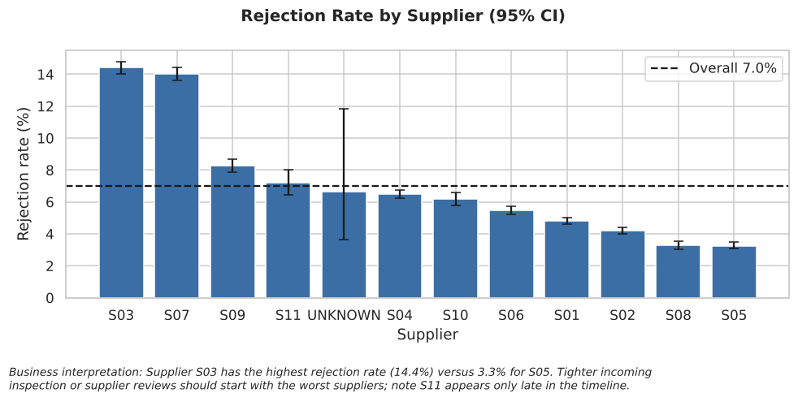

**Business interpretation:** Supplier S03 has the highest rejection rate (14.4%) versus 3.3% for S05. Tighter incoming inspection or supplier reviews should start with the worst suppliers; note S11 appears only late in the timeline.

## Rejection Rate by Shift (95% CI)

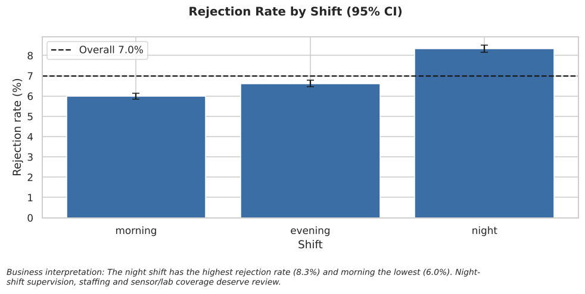

**Business interpretation:** The night shift has the highest rejection rate (8.3%) and morning the lowest (6.0%). Night-shift supervision, staffing and sensor/lab coverage deserve review.

## Moisture Distribution by Outcome

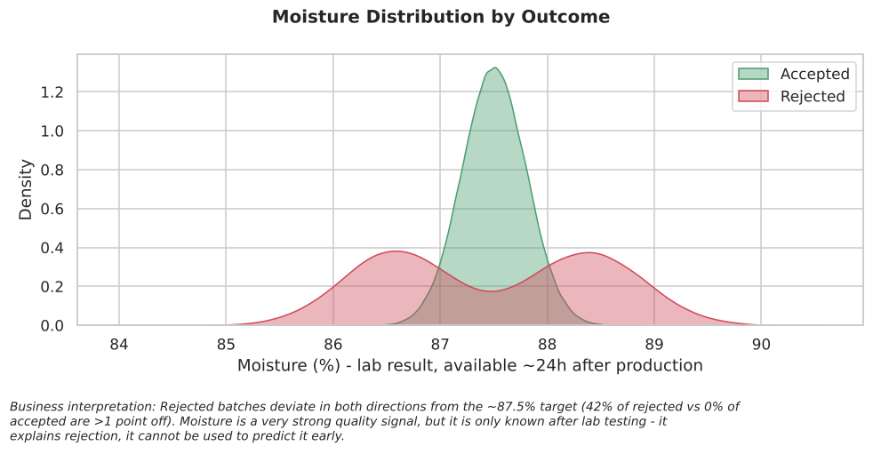

**Business interpretation:** Rejected batches deviate in both directions from the ~87.5% target (42% of rejected vs 0% of accepted are >1 point off). Moisture is a very strong quality signal, but it is only known after lab testing - it explains rejection, it cannot be used to predict it early.

## Machine Temperature Distribution by Outcome

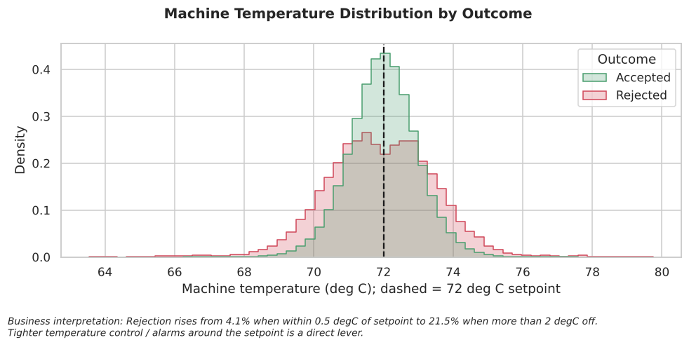

**Business interpretation:** Rejection rises from 4.1% when within 0.5 degC of setpoint to 21.5% when more than 2 degC off. Tighter temperature control / alarms around the setpoint is a direct lever.

## Downtime Analysis

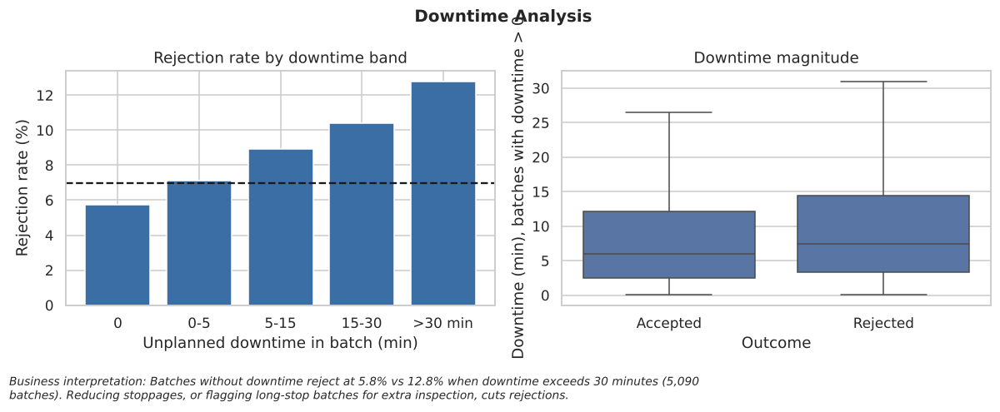

**Business interpretation:** Batches without downtime reject at 5.8% vs 12.8% when downtime exceeds 30 minutes (5,090 batches). Reducing stoppages, or flagging long-stop batches for extra inspection, cuts rejections.

## Spearman Correlation Heatmap

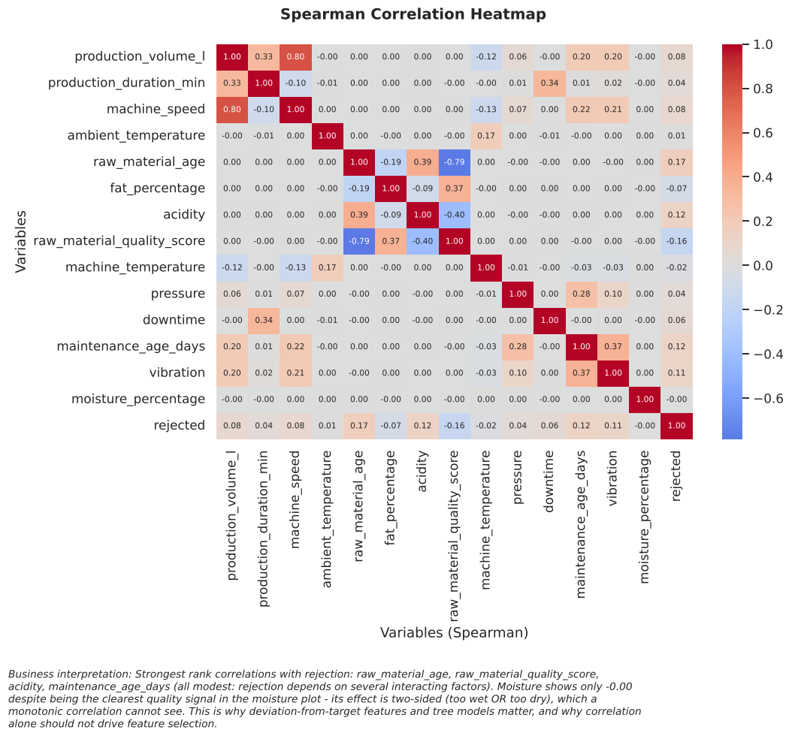

**Business interpretation:** Strongest rank correlations with rejection: raw_material_age, raw_material_quality_score, acidity, maintenance_age_days (all modest: rejection depends on several interacting factors). Moisture shows only -0.00 despite being the clearest quality signal in the moisture plot - its effect is two-sided (too wet OR too dry), which a monotonic correlation cannot see. This is why deviation-from-target features and tree models matter, and why correlation alone should not drive feature selection.

## Missing-Value Analysis

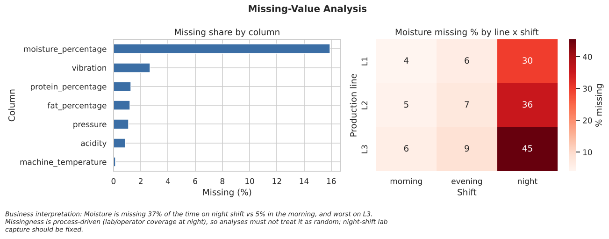

**Business interpretation:** Moisture is missing 37% of the time on night shift vs 5% in the morning, and worst on L3. Missingness is process-driven (lab/operator coverage at night), so analyses must not treat it as random; night-shift lab capture should be fixed.

## Monthly Rejection Trend

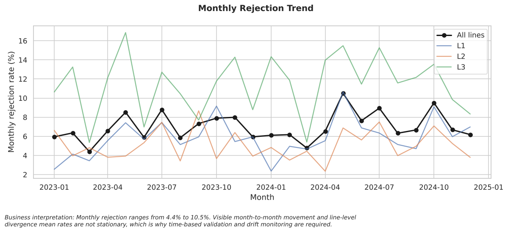

**Business interpretation:** Monthly rejection ranges from 4.4% to 10.5%. Visible month-to-month movement and line-level divergence mean rates are not stationary, which is why time-based validation and drift monitoring are required.

## Supplier Performance: Freshness vs Rejection (bubble = volume)

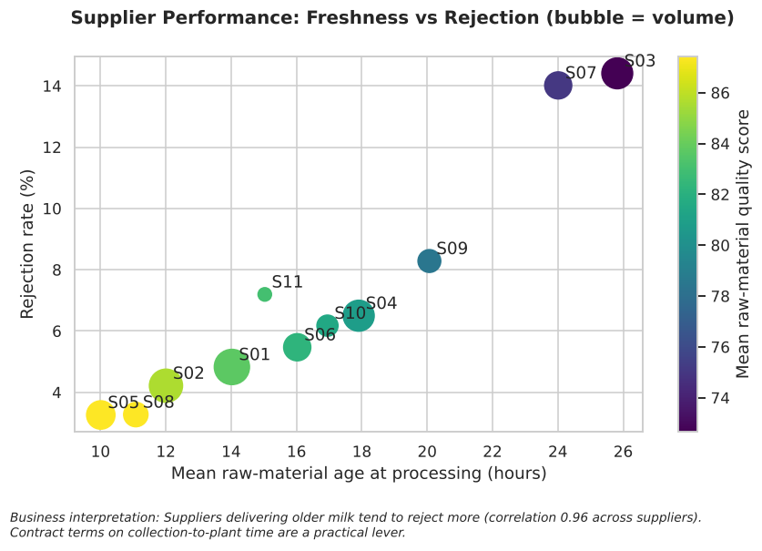

**Business interpretation:** Suppliers delivering older milk tend to reject more (correlation 0.96 across suppliers). Contract terms on collection-to-plant time are a practical lever.

## Production Line Comparison

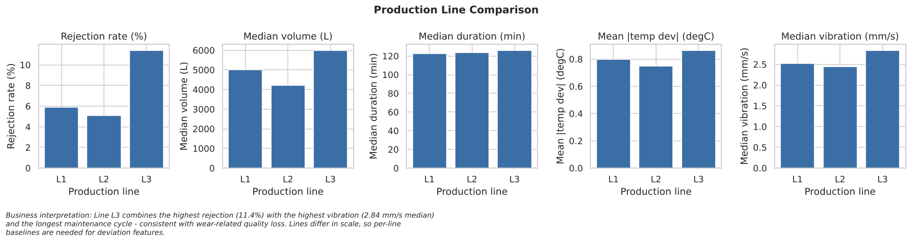

**Business interpretation:** Line L3 combines the highest rejection (11.4%) with the highest vibration (2.84 mm/s median) and the longest maintenance cycle - consistent with wear-related quality loss. Lines differ in scale, so per-line baselines are needed for deviation features.

## Outlier Analysis (retained, not removed)

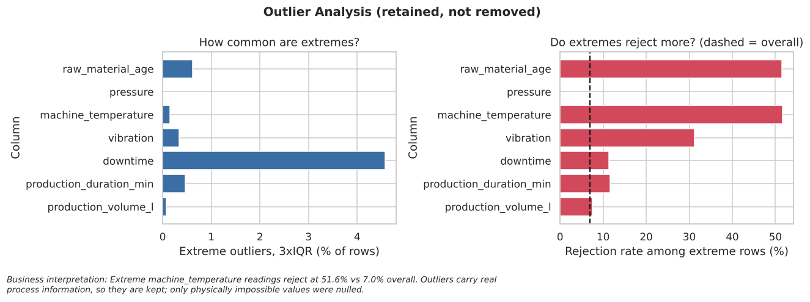

**Business interpretation:** Extreme machine_temperature readings reject at 51.6% vs 7.0% overall. Outliers carry real process information, so they are kept; only physically impossible values were nulled.

